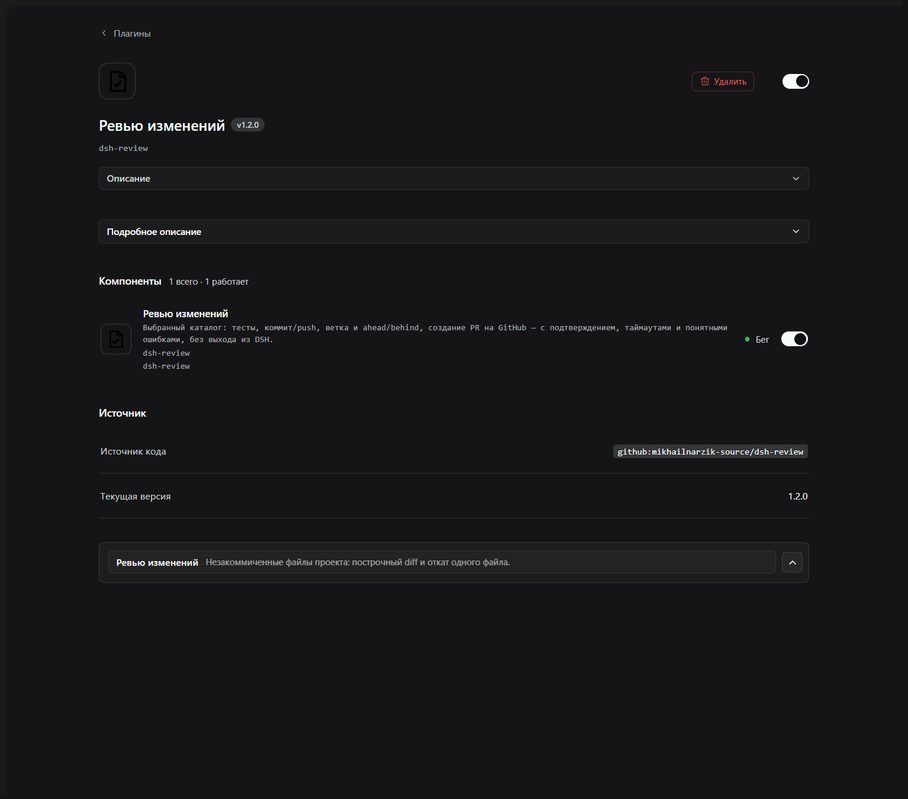

# dsh-review

Ревью изменений, тесты, коммит и push, ветка и создание pull request — прямо в DSH,
без перехода в терминал.



*Страница плагина в интерфейсе DSH.*

## Что это и зачем

DSH (DeepSeek Harness) — приложение, в котором вы общаетесь с ассистентом и
работаете с файлами проекта. Плагин работает с git-репозиториями этих проектов.
Git — система контроля версий: она запоминает историю файлов, а вы решаете, какие
изменения сохранить.

Основные слова, которые встретятся дальше:

| Термин | Что это простыми словами |
|---|---|
| Изменения | файлы, которые вы правили после последнего сохранения в истории |
| Diff | построчный показ: что добавлено, что удалено |
| Коммит | сохранение изменений в историю с сообщением |
| Push | отправка коммитов на сервер (GitHub) |
| Ветка (branch) | отдельная линия истории; в `main` лежит основная |
| ahead / behind | сколько ваших коммитов ещё не на сервере и сколько чужих вы не забрали |
| Pull request (PR) | предложение влить вашу ветку в основную на GitHub |
| Воркспейс | рабочая папка DSH; отсюда выбираются проекты |

Плагин отвечает за рабочее место после правок: показывает, что изменено, даёт
посмотреть diff, откатить один файл, прогнать тесты, закоммитить с push и создать
PR. Каждое опасное действие сначала спрашивает подтверждение и показывает, какие
файлы затронет.

Ассистент тоже получает инструменты — `changes_review`, `tests_run`, `git_commit`,
`git_push`, `branch_info` и `pr_create`, — поэтому может сделать то же самое по
вашей просьбе.

## Как открыть

1. Левая панель → «Плагины».
2. Карточка «Ревью изменений» (пакет `dsh-review`) → страница плагина.
3. Раздел «Ревью изменений» открыт сразу: шапка с иконкой 📝, названием,
   подсказкой и статус-чипом, кнопки «Обновить» / «Свернуть»; ниже секции
   «Проект» и «Изменения».

На странице: строка «Ветка: … · N↑/N↓», список файлов, кнопки «Прогнать тесты»,
«Закоммитить и запушить», «Создать PR» и список «Каталог».

## Как пользоваться пошагово

**Посмотреть изменения и diff.**

1. Откройте карточку плагина.
2. Ожидаемый результат: список файлов. Слева вид файла (`изменён`, `новый`,
   `удалён`, `переименован`, `конфликт`, `в индексе`), справа статистика
   `+N / −M`.
3. Нажмите на файл — откроется diff. Ожидаемый результат: добавленные строки
   зелёные, удалённые красные, заголовки кусков синие.

**Откатить один файл.**

1. У файла нажмите «Откатить».
2. Появится вопрос «Откатить этот файл?» и кнопки «Да, откатить» / «Отмена».
3. Ожидаемый результат: отслеживаемый файл вернулся к последнему коммиту, новый
   файл удалён. Список обновится.

**Прогнать тесты.**

1. Проверьте каталог в списке «Каталог» (если кандидатов несколько).
2. Нажмите «Прогнать тесты».
3. Ожидаемый результат: панель результата. Заголовок «Тесты прошли», «Тесты
   упали» или «Тесты не уложились в таймаут», рядом длительность, ниже вывод.
   Если формат вывода знакомый, будут числа прошедших и упавших тестов.
4. Пока идёт запуск, кнопка показывает «Выполняется…»; по завершении состояние
   сбрасывается в любом случае.

**Закоммитить и запушить.**

1. Нажмите «Закоммитить и запушить».
2. Ожидаемый результат: панель подтверждения с количеством файлов, путём
   репозитория, веткой, предупреждениями и полем «Сообщение коммита».
3. Впишите сообщение и нажмите «Подтвердить». Без сообщения будет «Введите
   сообщение коммита.».
4. Ожидаемый результат: «Коммит …» и «Push выполнен» с веткой, remote и кодом
   выхода. При ошибке — её текст, включая строки `fatal:` из git.

**Создать pull request.**

1. Нажмите «Создать PR».
2. Ожидаемый результат: панель «Создание pull request: <ветка> → <база>» с полями
   «Название», «Описание», «Базовая ветка», «Ветка PR».
3. Проверьте предупреждения. Если ветка совпадает с базовой или origin не GitHub,
   PR создать нельзя.
4. Нажмите «Подтвердить». Ожидаемый результат: «PR создан» или «PR уже
   существует» со ссылкой.

**Если проект ещё не под git.**

1. Вместо списка файлов будет «Проект пока не под git.» и кнопка «Создать
   репозиторий git».
2. Подтвердите. Ожидаемый результат: «Репозиторий создан» и первый коммит.

## Примеры

**Команды ассистенту.**

> Покажи незакоммиченные изменения в `.publish/dsh-cards`.

Ассистент вызовет `changes_review` и вернёт файлы и статистику строк.

> Прогони тесты в `.publish/dsh-review` с таймаутом 900 секунд.

`tests_run({ "dir": ".publish/dsh-review", "timeoutSec": 900 })`.

> Закоммить изменения в `.publish/dsh-cards` с сообщением «docs: для новичков» и
> запушь в origin.

Ассистент вызовет `git_commit` с `confirm: true`, затем `git_push`.

> Покажи ветку, ahead/behind и создай PR в main с заголовком «Docs: newcomer
> guides».

Это `branch_info`, затем `pr_create`.

**Тесты для разных проектов** — команда выбирается сама:

| Что в каталоге | Команда |
|---|---|
| `package.json` со `scripts.test` | `npm test` (при `pnpm-lock.yaml` — `pnpm test`) |
| только `pnpm-lock.yaml` | `pnpm test` |
| `gradlew.bat` / `gradlew` | `gradlew.bat test` / `./gradlew test` |
| `*.sln` / `*.csproj` | `dotnet test "<путь>"` |
| ничего из перечисленного | `npm test` |

**Поле для тестов.** Если нужен нестандартный запуск, ассистент может передать
команду явно: `tests_run({ "dir": ".publish/x", "command": "npm test -- --watch=false" })`.

**Маршруты** (для разработки; все `POST`, ответ JSON):

| Маршрут | Назначение |
|---|---|
| `/api/dsh-review/state` | список изменённых файлов и статистика |
| `/api/dsh-review/diff` | построчный diff файла |
| `/api/dsh-review/revert` | откат файла (`confirm: true`) |
| `/api/dsh-review/init` | `git init` и первый коммит (`confirm: true`) |
| `/api/dsh-review/projects` | каталоги с тестами |
| `/api/dsh-review/tests-run` | запуск тестов (`dir?`, `command?`, `timeoutSec?`) |
| `/api/dsh-review/git-status` | состояние репозитория выбранного каталога |
| `/api/dsh-review/git-commit` | коммит (`message`, `paths?`, `confirm: true`) |
| `/api/dsh-review/git-push` | push (`confirm: true`, `remote?`, `branch?`) |
| `/api/dsh-review/branch-info` | ветка, ahead/behind, база, коммиты |
| `/api/dsh-review/pr-create` | создание PR (`title`, `body?`, `base?`, `head?`, `confirm: true`) |

## Что вы увидите

| Элемент | Как выглядит |
|---|---|
| Шапка | иконка 📝, «Ревью изменений», подсказка, статус-чип и кнопки «Обновить» / «Свернуть» |
| Секции | «Проект» (каталог, ветка, действия) и «Изменения» (сводка, файлы, diff) по центру, до 960 px |
| «Обновить» | перечитывает изменения, каталоги и данные ветки |
| Строка ветки | «Ветка: `main` · `2`↑/`0`↓»; при ошибке — красный текст |
| Файл | название с цветом по виду, справа `+N / −M` |
| Diff | строки зелёные/красные, заголовки кусков синие, служебные строки серые |
| «Откатить» | красная кнопка и подтверждение «Да, откатить» / «Отмена» |
| Список «Каталог» | найденные проекты с тестами; подпись — имя из `package.json` и путь |
| Панель тестов | итог, длительность, каталог, вывод; при обрезке — пометка «Вывод обрезан» |
| Панель коммита | вопрос, файлы, путь репозитория, ветка, предупреждения, поле сообщения |
| Панель PR | ветка → база, поля, предупреждения, «Подтвердить» / «Отмена» |
| «Выполняется…» | состояние кнопки на время запроса; сбрасывается всегда |

## Частые ошибки и что делать

| Симптом | Причина | Что делать |
|---|---|---|
| «Незакоммиченных изменений нет.» | всё уже сохранено | Так и должно быть; правьте файлы |
| «Проект пока не под git.» | в каталоге нет репозитория | «Создать репозиторий git» |
| «Это установленная копия, а не отдельный репозиторий: git-корень — "…"…» | выбрана папка `plugins/<имя>` — она не свой репозиторий | Выберите каталог в `.publish/<имя>` |
| «Несколько каталогов с тестами — выберите один в списке.» | в воркспейсе несколько проектов | Выберите «Каталог» в списке |
| «Не найден package.json с scripts.test, gradlew или `*.sln`/`*.csproj`» | в каталоге нет тестов | Выберите другой каталог или запустите тесты вручную |
| «Введите сообщение коммита.» | пустое поле | Заполните сообщение |
| «нет изменений для коммита» | все изменения уже закоммичены | Обновите карточку |
| «отказ: в изменениях есть файлы, похожие на секреты: …» | в изменениях `.env`, `*.key`, `*secret*`, `credentials*`, `*.pem` | Уберите секреты из индекса и добавьте в `.gitignore` |
| «отказ: в изменениях есть опасные пути: …» | в изменениях `node_modules/`, `.npm-cache/`, `.pnpm-store/`, `.artifacts/`, `*.log` | Добавьте их в `.gitignore` и повторите |
| «отказ: изменённых файлов N (лимит 500)…» | каталог целиком не готов к коммиту | Добавьте большие папки в `.gitignore` или коммитьте по путям |
| «origin не GitHub — создать PR нельзя.» | удалённый репозиторий не на GitHub | Push в GitHub и повторите |
| «Ветка PR совпадает с базовой…» | вы на `main` | Переключитесь на отдельную ветку |
| «Настройки → Плагины → GitHub» | не сохранён токен | Введите Personal access token |
| `fatal: …` в панели результата | git отказал | Читайте текст ошибки: обычно права, конфликт или отсутствие ветки |
| «Таймаут запроса» | операция не уложилась в 180 с | Повторите; для больших репозиториев коммитьте меньше файлов |

## Ограничения и безопасность

- Работа только внутри каталогов проекта: путь `../secret.txt` отклоняется.
- Git-репозиторий должен быть ровно выбранным каталогом. Подкаталог чужого
  репозитория (типичная установленная копия `plugins/<имя>`) отклоняется с
  подсказкой.
- Откат, коммит, push и создание PR требуют `confirm: true`; в интерфейсе — явное
  «Подтвердить».
- Перед коммитом плагин запрещает файлы, похожие на секреты, и опасные пути
  (`node_modules/`, `.npm-cache/`, `.pnpm-store/`, `.artifacts/`, `*.log`), а также
  отказывается от коммита больше 500 файлов.
- Force push не выполняется никогда. Push в `main`/`master` помечается в ответе.
  Push не создаёт upstream.
- GitHub-токен берётся из хранилища секретов DSH (`GITHUB_TOKEN`) и не пишется в
  файлы и ответы. Сеть — только `https://api.github.com`.
- Из внешних команд используются `git` и команда тестов; аргументы git
  фиксированы, имена файлов и веток не могут подставить чужую опцию. Параметр
  `command` у `tests_run` — осознанная возможность для человека и агента.
- Показываются изменения относительно последнего коммита (`HEAD`). У нового файла
  без первого коммита diff строится по содержимому.
- Конфликты и переименования помечаются, но разрешаются вручную.
- Список файлов в карточке строится для корня воркспейса; выбранный «Каталог»
  влияет на тесты, коммит, push и PR. `git-status` отдаёт не больше 200 путей
  (полное число — в поле `total`).
- Установленные копии `plugins/*` в список «Каталог» не попадают.
- PR создаётся только для GitHub-remote `origin`, и ветку нужно заранее запушить.

## Связанные плагины

- `dsh-polish` — оформление карточки и экран «Состояние», где видно токен GitHub.
- `dsh-github-safe` — аккуратные GitHub-действия с подтверждением.
- `dsh-cards` — карточки в ответах; формат карточки тот же.
- `dsh-team` — панель команды: задачи для нескольких ассистентов.
- `dsh-sessions` — синхронизация истории сессий и резерв.

## Установка

```powershell
& "$env:LOCALAPPDATA\Programs\DeepSeek Harness\resources\runtime\cli\bin\dsh.cmd" `
  plugin --profile desktop add github:mikhailnarzik-source/dsh-review
```

После установки перезапустите DSH.

## Проверка

```powershell
node --test test/changes.test.mjs test/tests.test.mjs test/projects.test.mjs `
  test/git.test.mjs test/github.test.mjs test/registration.test.mjs
```

Покрыто: разбор git-выводов и diff, защита путей, откат в настоящем репозитории,
поиск каталогов с тестами, обрезка и разбор вывода тестов, таймауты, repo-скоуп
выбранного каталога, коммит и push в локальный bare-remote, ветка/ahead/behind,
создание PR с mock fetch и регистрация инструментов и маршрутов.
