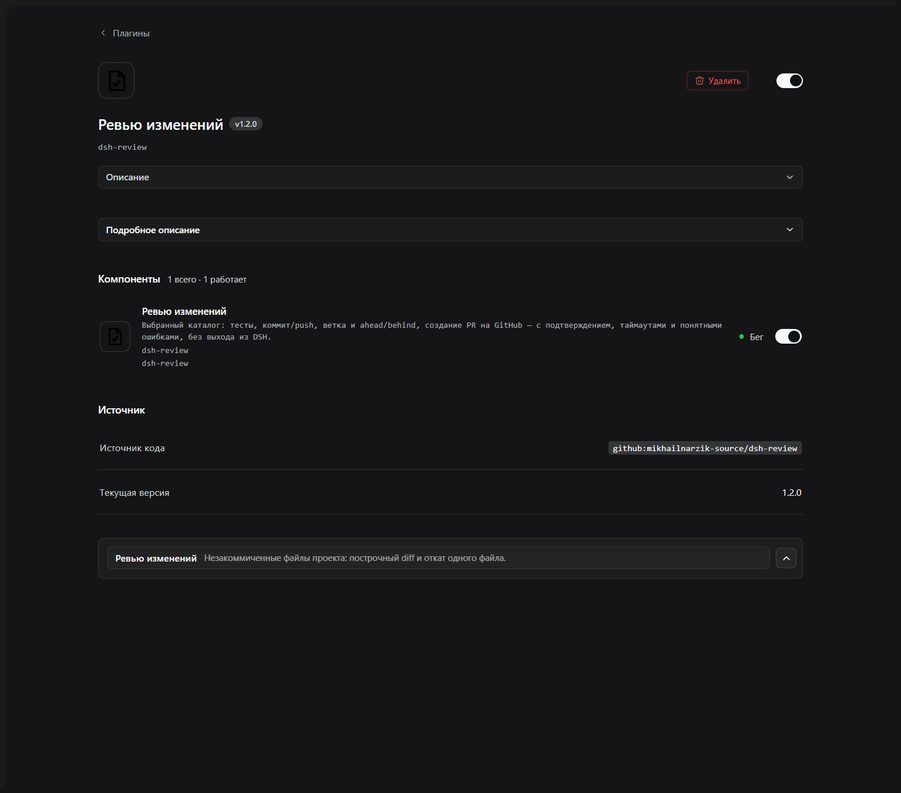
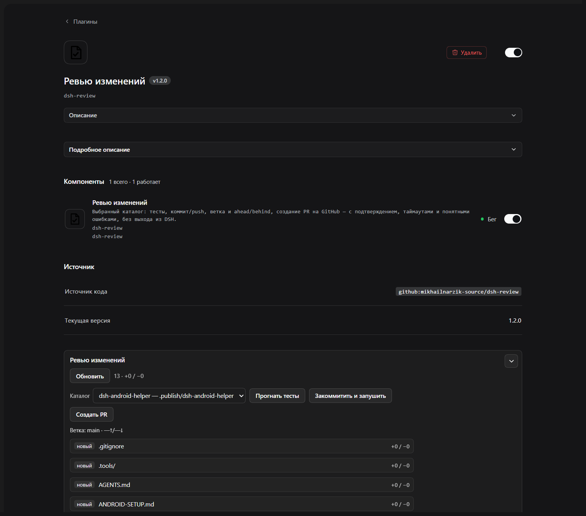

# dsh-review — подробное описание

Плагин делает из DSH рабочее место после правок: показать изменённые файлы и diff,
откатить один файл, прогнать тесты, закоммитить с push, посмотреть ветку и создать
pull request на GitHub.

## Что это и зачем

| Термин | Простыми словами |
|---|---|
| Git | система контроля версий: хранит историю файлов |
| Репозиторий | папка под git; в ней лежит скрытая `.git` |
| HEAD | последний коммит в текущей ветке |
| Рабочее дерево | файлы на диске, которые вы правите |
| Индекс (staged) | изменения, подготовленные к коммиту |
| Diff | построчное сравнение: `+` добавлено, `−` удалено |
| Коммит | сохранение подготовленных изменений в историю |
| Remote / origin | удалённый репозиторий, обычно на GitHub |
| Push | отправить коммиты в remote |
| Ветка | отдельная линия истории; `main` — основная |
| ahead / behind | своих коммитов ещё нет на сервере / чужих ещё нет у вас |
| Pull request | предложение влить ветку в основную на GitHub |
| Воркспейс | рабочая папка DSH; из неё выбираются проекты |

Зачем плагин: обычно после правок нужно несколько команд в терминале —
`git status`, `git diff`, `git add`, `git commit`, `git push`, — и легко ошибиться
с путём или отправить лишнее. Плагин делает то же самое кнопками, показывает, что
именно изменится, и требует подтверждения перед записью.

## Как открыть

1. Левая панель → «Плагины».
2. Карточка «Ревью изменений» (пакет `dsh-review`) → страница плагина.
3. Раздел «Ревью изменений» открыт сразу: шапка с иконкой 📝, названием,
   подсказкой и статус-чипом, кнопки «Обновить» / «Свернуть».
4. На странице: секция «Проект» (строка ветки, действия) и секция «Изменения»
   (сводка, файлы, diff и откат).

Если проект без git, вместо файлов будет «Проект пока не под git.» и кнопка
«Создать репозиторий git».

## Как пользоваться пошагово

**Изменения и diff.**

1. Откройте карточку. Ожидаемый результат: список файлов с видом
   (`изменён`, `новый`, `удалён`, `переименован`, `конфликт`, `в индексе`) и
   статистикой `+N / −M`.
2. Нажмите файл. Ожидаемый результат: diff с подсветкой; строки размечены как
   `add`, `del`, `hunk`, `meta`, `context`.
3. Нажмите «Обновить», чтобы перечитать состояние после правок в редакторе.

**Откат файла.**

1. Нажмите «Откатить», затем «Да, откатить».
2. Ожидаемый результат: отслеживаемый файл (`M`, `A`, `R`) возвращается через
   `git checkout -- <путь>`; неотслеживаемый (`??`) удаляется с диска.
3. Отказ без `confirm: true` — защита от случайного вызова.

**Тесты.**

1. Выберите «Каталог» (если в воркспейсе несколько проектов).
2. Нажмите «Прогнать тесты».
3. Ожидаемый результат: итог, длительность, каталог, вывод. Начало и хвост вывода
   сохраняются, середина заменяется пометкой «…обрезано…». Итоги
   `passed`/`failed` разбираются, если формат знаком (node --test, mocha/jest,
   pytest, dotnet, maven), иначе будут `null`.
4. Пока идёт запуск — «Выполняется…»; состояние сбрасывается в `finally` и после
   успеха, и после ошибки, и после таймаута.

**Коммит и push.**

1. Нажмите «Закоммитить и запушить». Плагин сначала спросит
   `/api/dsh-review/git-status` для выбранного каталога и покажет файлы, реальный
   путь репозитория, ветку и предупреждения.
2. Впишите «Сообщение коммита», нажмите «Подтвердить». Ожидаемый результат:
   «Коммит …» и «Push выполнен», либо ошибка с последними строками вывода git.
3. Коммит делается в репозитории выбранного каталога. Push — только
   `git push <remote> <branch>`, без `--force` и без создания upstream.

**Ветка и PR.**

1. Строка «Ветка: `<branch>` · `<ahead>`↑/`<behind>`↓» показывает состояние
   выбранного каталога; рядом — «Создать PR».
2. «Создать PR» сначала читает данные ветки, затем открывает панель с title (по
   умолчанию имя ветки, `_` → пробел), body (коммиты `base..HEAD`, до 20 строк),
   base и head.
3. Проверьте предупреждения и нажмите «Подтвердить». Ожидаемый результат: «PR
   создан» или «PR уже существует» со ссылкой.

**Первый коммит в новом каталоге.**

1. «Создать репозиторий git» → подтверждение.
2. Ожидаемый результат: `git init` и первый коммит, «Репозиторий создан».

## Примеры

**Инструменты для ассистента.**

| Инструмент | Параметры | Что делает |
|---|---|---|
| `changes_review` | `path?` | список изменённых файлов и статистика; с `path` — diff файла |
| `tests_run` | `dir?`, `command?`, `timeoutSec?` | поиск каталога, автодетект команды, запуск, обрезка вывода |
| `git_commit` | `dir?`, `message`, `paths?` / `"all"`, `confirm: true` | коммит с проверками |
| `git_push` | `dir?`, `confirm: true`, `remote?`, `branch?` | push без force |
| `branch_info` | `dir?` | ветка, remote, upstream, ahead/behind, base, коммиты |
| `pr_create` | `dir?`, `title`, `body?`, `base?`, `head?`, `confirm: true` | PR на GitHub |

Примеры вызовов:

```json
{ "tool": "changes_review", "path": ".publish/dsh-cards/README.md" }
{ "tool": "tests_run", "dir": ".publish/dsh-review", "timeoutSec": 900 }
{ "tool": "git_commit", "dir": ".publish/dsh-cards", "message": "docs: для новичков", "confirm": true }
{ "tool": "git_push", "dir": ".publish/dsh-cards", "confirm": true }
{ "tool": "pr_create", "dir": ".publish/dsh-cards", "title": "Docs: newcomer guides", "confirm": true }
```

**Команды ассистенту (по-русски).**

> Покажи, что изменено в `.publish/dsh-polish`, и открой diff `docs/DETAIL.md`.

> Прогони тесты в `.publish/dsh-review` и скажи, сколько прошло.

> Закоммить `.publish/dsh-cards` с сообщением «docs: переписано для новичков» и
> запушь.

**Выбор каталога и команды тестов.**

- `tests_run` принимает `dir` относительно корня воркспейса (`.` — сам корень).
- Корень подходит, только если в нём есть манифест; иначе поиск идёт по каталогам
  глубины 1–2 и пропускает `node_modules`, `.git`, `dist`, `build`, `plugins`
  (установленные копии). Максимум — 60 кандидатов.
- Один кандидат запускается сразу, при нескольких возвращается `needsChoice` и
  нужен явный `dir`.
- Команда: `npm test` / `pnpm test` по `package.json` (pnpm — при
  `pnpm-lock.yaml`), `gradlew.bat test` / `./gradlew test`, `dotnet test "<путь>"`,
  иначе `npm test`.

**Маршруты** (все `POST`, ответ JSON):

| Маршрут | Тело / назначение |
|---|---|
| `/api/dsh-review/state` | список изменённых файлов и статистика |
| `/api/dsh-review/diff` | `{path}` — построчный diff |
| `/api/dsh-review/revert` | `{path, untracked?, confirm: true}` |
| `/api/dsh-review/init` | `{confirm: true}` — `git init` и первый коммит |
| `/api/dsh-review/projects` | `{ok, dir, candidates}` |
| `/api/dsh-review/tests-run` | `{dir?, command?, timeoutSec?}` |
| `/api/dsh-review/git-status` | `{dir}` → `{repo, repoPath, branch, files, total, warnings}` |
| `/api/dsh-review/git-commit` | `{dir?, message, paths?, confirm: true}` |
| `/api/dsh-review/git-push` | `{dir?, remote?, branch?, confirm: true}` |
| `/api/dsh-review/branch-info` | `{dir}` |
| `/api/dsh-review/pr-create` | `{dir?, title, body?, base?, head?, confirm: true}` |

## Что вы увидите

**Страница.** Шапка с иконкой 📝, заголовком «Ревью изменений», подсказкой,
статус-чипом (число изменённых файлов, «Чисто», «Загрузка…» или «Ошибка») и
кнопками «Обновить» / «Свернуть». Ниже — секция «Проект» (каталог с тестами,
строка ветки, кнопки «Прогнать тесты», «Закоммитить и запушить», «Создать PR»)
и секция «Изменения» (сводка, список файлов, diff и откат).

**Список файлов.** У каждого файла цвет и подпись по виду: `в индексе`, `новый`,
`изменён`, `удалён`, `переименован`, `конфликт`. Справа `+N / −M`. Выбранный файл
подсвечен рамкой.

**Diff.** Добавленные строки зелёные, удалённые красные, заголовки кусков синие,
служебные строки (`meta`) приглушены.

**Панель тестов.** «Тесты прошли» / «Тесты упали» / «Тесты не уложились в таймаут»,
длительность, каталог, вывод. При обрезке — «Вывод обрезан: показаны начало и
хвост.».

**Панель коммита.** «Закоммитить и запушить эти изменения?», количество файлов,
путь репозитория, ветка, предупреждения, поле «Сообщение коммита», кнопки
«Подтвердить» / «Отмена». Пустое сообщение не проходит: «Введите сообщение
коммита.».

**Панель PR.** «Создание pull request: `<head>` → `<base>`», поля «Название»,
«Описание», «Базовая ветка», «Ветка PR», предупреждения, «Подтвердить» /
«Отмена». Ошибки 401/403/404/422/429 приходят по-русски, например «GitHub: токен
не принят (401)».

**Состояния.** Любое длинное действие показывает «Выполняется…» и блокирует
кнопки; запросы ограничены 180 секундами, состояние сбрасывается всегда.


## Как это выглядит



*Рисунок 1. Страница плагина: описание, настройки и кнопки.*



*Рисунок 2. Рабочий раздел плагина: органы управления и результат.*

Страница оформлена в едином стиле: контент по центру шириной до 960 px, шапка с
квадратной иконкой 52×52, статус-чипом и кнопками, карточки-секции со
скруглением 14 px и акцентной полоской у заголовка. Кнопки — 36 px, поля ввода —
34 px, у строк списка файлов есть наведение; уже 760 px страница становится одной
колонкой. Цвета берутся только из токенов темы DSH, поэтому светлая и тёмная
темы выглядят одинаково аккуратно.

## Как это устроено

| Часть | Файл | Что делает |
|---|---|---|
| Ревью | `lib/changes.mjs` | `git status --porcelain -z`, `git diff --numstat HEAD`, diff файла, откат |
| Тесты | `lib/tests.mjs` | поиск каталогов, автодетект команды, spawn с таймаутом, обрезка и разбор вывода |
| Git-запись | `lib/git.mjs` | repo-скоуп, статус, коммит с проверками, push без force |
| GitHub | `lib/github.mjs` | remote, ветка, ahead/behind, base, создание PR |
| Пути | `lib/paths.mjs` | «внутри корня» лексически и по реальному пути (симлинки) |
| Host | `index.js` | одиннадцать маршрутов и шесть инструментов |
| Клиент | `client.js` | карточка: файлы, diff, откат, тесты, коммит/push, ветка, PR |

Модули `lib/*.mjs` не знают про DSH: на вход каталог, на выход структуры. Поэтому
их проверяют тестами без запуска приложения.

**Ограничения значений.** Таймаут тестов по умолчанию 600 с (максимум 3600).
Вывод ограничен 12000 символами: начало 2000 + пометка + хвост 8000. Сообщение
коммита — до 5000 символов, название PR — до 256. `git-status` отдаёт не больше
200 путей (полное число — в `total`). Список изменённых файлов считается через
`git status --porcelain -z`; неотслеживаемые файлы считаются честно через
`git ls-files --others --exclude-standard`, поэтому большой каталог получает отказ
по числу, а не зависание `git add`.

## Частые ошибки и что делать

| Симптом | Причина | Что делать |
|---|---|---|
| «Незакоммиченных изменений нет.» | всё сохранено | Правьте файлы и обновите карточку |
| «Проект пока не под git.» | нет `.git` | «Создать репозиторий git» |
| «Это установленная копия, а не отдельный репозиторий: git-корень — "…"…» | выбран `plugins/<имя>` | Выберите каталог `.publish/<имя>` |
| «путь вне репозитория: …» | в `paths` попал путь наружу | Передавайте пути внутри каталога |
| «Несколько каталогов с тестами — выберите один в списке.» | кандидатов больше одного | Выберите «Каталог» |
| «Не найден package.json с scripts.test, gradlew или *.sln/*.csproj …» | нет тестов в каталоге | Выберите проект или задайте команду |
| «нет изменений для коммита» | нечего коммитить | Обновите карточку |
| «Введите сообщение коммита.» | пустое поле | Заполните сообщение |
| «отказ: в изменениях есть файлы, похожие на секреты: …» | `.env`, `*.key`, `*secret*`, `credentials*`, `*.pem` | Уберите из индекса, добавьте в `.gitignore` |
| «отказ: в изменениях есть опасные пути: …» | `node_modules/`, `.npm-cache/`, `.pnpm-store/`, `.artifacts/`, `*.log` | Добавьте в `.gitignore` |
| «отказ: изменённых файлов N (лимит 500)…» | слишком много файлов | `.gitignore` для больших папок или коммит по путям |
| «git add завершился ошибкой (код N): fatal: …» | git отказал | Читайте последние строки вывода: права, блокировка, место на диске |
| «remote origin не GitHub — создать PR нельзя.» | origin указывает не на GitHub | Настройте origin на github.com |
| «ветка main совпадает с base — переключитесь на отдельную ветку» | PR из `main` в `main` | Создайте ветку и запушьте её |
| «токен GitHub не сохранён: Настройки → Плагины → GitHub» | нет токена | Введите Personal access token |
| «GitHub: репозиторий не найден или нет доступа (404)» | нет прав или опечатка в remote | Проверьте доступ к репозиторию |
| «GitHub: запрос отклонён (422)…» | ветка не запушена или PR уже есть | Запушьте ветку; проверьте существующие PR |
| «GitHub не ответил за 60 с» | сеть | Повторите позже |
| «Таймаут запроса» | запрос интерфейса не уложился в 180 с | Повторите, уменьшите объём |

## Ограничения и безопасность

- Проверяются только файлы внутри каталога проекта; `../secret.txt` отклоняется
  ещё до вызова git. Для тестов и git используется одно правило «внутри корня» с
  учётом реального пути.
- Git-репозиторий должен совпадать с выбранным каталогом: подкаталог чужого
  репозитория (установленная копия) отклоняется. Корень воркспейса разрешён, если
  он сам является корнем репозитория.
- Откат, коммит, push и PR требуют `confirm: true`; интерфейс дополнительно
  показывает файлы до подтверждения.
- Коммит блокируют файлы, похожие на секреты, опасные пути и превышение лимита
  500 файлов. `git status`, `git add` и `git commit` идут с таймаутом 120 с и
  убийством дерева процесса — огромный каталог не подвешивает интерфейс.
- Force push не выполняется никогда: только `git push <remote> <branch>`. Push в
  `main`/`master` помечается в ответе. Upstream не создаётся.
- GitHub: URL собирается только от константы `https://api.github.com`, токен
  берётся из credential store (`GITHUB_TOKEN`) и не пишется в файлы и ответы,
  таймаут 60 с. Прочие адреса отклоняются.
- Из внешних команд используются только `git` и команда тестов. Аргументы git
  фиксированы, а имя файла или ветки не может подставить чужую опцию. Параметр
  `command` у `tests_run` — осознанная возможность, а не результат подстановки из
  данных проекта.
- Показываются изменения относительно `HEAD`; у новых файлов без первого коммита
  diff строится по содержимому.
- Конфликты и переименования помечаются, но разрешаются вручную. Истории коммитов
  и выбора конкретного коммита для push нет.
- Список файлов в карточке строится для корня воркспейса; выбранный «Каталог»
  влияет на тесты, коммит, push и PR. `git-status` отдаёт до 200 путей.
- Установленные копии `plugins/*` в список «Каталог» не попадают: у них нет
  собственного репозитория.
- PR создаётся только для GitHub-remote `origin`, ветка должна быть запушена.

## Связанные плагины

- `dsh-polish` — оформление карточки и проверка «Токен GitHub».
- `dsh-github-safe` — GitHub-действия с отдельным подтверждением.
- `dsh-cards` — карточки в ответах, общий формат.
- `dsh-team` — панель задач для нескольких помощников.
- `dsh-sessions` — синхронизация истории сессий.
- `dsh-compact` — сжатие журнала сессии, если работы накопилось много.

## Проверка

```powershell
node --test test/changes.test.mjs test/tests.test.mjs test/projects.test.mjs `
  test/git.test.mjs test/github.test.mjs test/registration.test.mjs
```

Покрыто: разбор git-выводов и разметка diff, защита путей, откат в настоящем
репозитории, поиск каталогов с тестами (без `plugins/*`) и запрет выхода за корень,
обрезка и разбор вывода тестов, таймаут тестов, repo-скоуп выбранного каталога и
отказ для подкаталогов чужого репозитория, подсчёт файлов до `git add` (включая
большие неотслеживаемые каталоги и `.gitignore`), показ `fatal:` из git-ошибок,
таймауты git-операций, отказ при секретах и опасных путях, коммит и push в
локальный bare-remote, разбор remote, ветку/ahead/behind и base, создание PR с
mock fetch (существующий PR, 422, нет токена, confirm), регистрация инструментов и
маршрутов.
